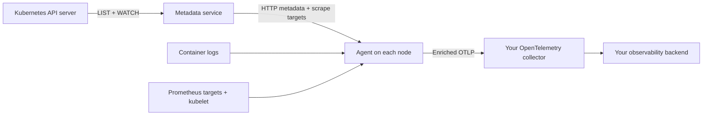

# kubescrape

**Kubernetes logs and Prometheus metrics, with workload context built in.**

[](https://github.com/JohanLindvall/kubescrape/releases/latest)
[](https://github.com/JohanLindvall/kubescrape/actions/workflows/ci.yml)
[](https://pkg.go.dev/github.com/JohanLindvall/kubescrape)
[](LICENSE)
[](go.mod)

Collect container logs and Prometheus metrics, attach pod, workload and
namespace metadata, and send them to your OpenTelemetry collector over OTLP.
kubescrape pairs a shared **metadata service** with a **per-node agent**, so
platform teams can collect telemetry from long-running services and short-lived
Jobs through the same pipeline.

[Install](#install) · [Try the demo](#try-it-locally) ·
[Documentation](#documentation) · [Compare alternatives](docs/COMPARISON.md) ·
[Contribute](CONTRIBUTING.md) · [Get help](SUPPORT.md)

## Why kubescrape?

- **Know which workload produced a log.** Container logs wait for metadata
  before being read. Owner chains resolve ReplicaSets to Deployments and Jobs
  to CronJobs; deleted containers remain discoverable for a configurable TTL.
- **Share Kubernetes discovery across your agents.** Each metadata-service
  replica watches the API server once per resource. Agents fetch metadata and
  scrape targets over HTTP with ETag caching; lookups cause no API-server calls.
- **Keep log delivery tied to acknowledgements.** The default tailer commits
  offsets after successful export and reconstructs multiline entries across
  observed rotations and restarts. Optional disk buffering handles collector
  outages. [Delivery semantics and limits](docs/REFERENCE.md#the-node-agent)
  spell out retry, permanent-rejection and rotation behavior.
- **Use the discovery you already have.** Scrape `prometheus.io/*` annotations
  on pods and Services, or opt into ServiceMonitor and PodMonitor support.
  Export to an OTLP receiver in your existing observability stack.

<a id="overview"></a>

## How it works



<a id="api"></a>
<a id="the-node-agent"></a>
<a id="traces-the-trace-tier"></a>

The metadata service is also usable on its own through its
[HTTP API](docs/REFERENCE.md#api). Optional pipelines add systemd journal logs,
Kubernetes events and Azure diagnostics; a separate trace tier handles service
graphs, span metrics and sampling. See the [technical reference](docs/REFERENCE.md)
for their deployment requirements.

<details>
<summary>See an exported container log record</summary>

```yaml
# One container log line, as the agent exports it (abridged)
resource:
  k8s.namespace.name: shop
  k8s.deployment.name: checkout            # the owner chain, resolved
  k8s.replicaset.name: checkout-7d9c8b6f5
  k8s.pod.name: checkout-7d9c8b6f5-x2x4k
  k8s.container.name: checkout
  container.image.name: registry.example.com/shop/checkout:1.42.0
  k8s.node.name: worker-2
  service.name: checkout                   # derived from the Deployment
  service.namespace: shop
  k8s.pod.label.app.kubernetes.io/name: checkout   # every pod and namespace label
  # … plus k8s.pod.uid, k8s.pod.ip, container.id and service.instance.id
log_record:
  body: '{"level":"error","msg":"payment declined","trace_id":"4bf92f3577b34da6a3ce929d0e0e4736","span_id":"00f067aa0ba902b7"}'
  severity_text: error                     # parsed from the line
  severity_number: 17                      # ERROR
  trace_id: 4bf92f3577b34da6a3ce929d0e0e4736
  span_id: 00f067aa0ba902b7
  attributes:
    log.iostream: stdout
```

</details>

<a id="helm-chart"></a>

## Install

You need a Kubernetes cluster with Linux nodes, Helm, and a reachable OTLP
collector. Replace `my-collector.observability:4317` with your collector's gRPC
endpoint. The default example uses plaintext OTLP inside the cluster; see the
[TLS and authentication options](docs/CONFIGURATION.md#agent-otlp-export) when
configuring a secured receiver.

```sh
helm install kubescrape \
  https://github.com/JohanLindvall/kubescrape/releases/download/v0.1.0/kubescrape-0.1.0.tgz \
  --namespace monitoring --create-namespace \
  --set agent.otlp.endpoint=my-collector.observability:4317 \
  --set service.otlp.endpoint=my-collector.observability:4317

kubectl -n monitoring rollout status deployment/kubescrape
kubectl -n monitoring rollout status daemonset/kubescrape-agent
```

The [latest release](https://github.com/JohanLindvall/kubescrape/releases/latest)
includes images for linux/amd64 and linux/arm64, a chart and manifests with the
image version pinned, static binaries, and `SHA256SUMS`. Prefer release assets
for deployments; a chart installed from this checkout defaults to `latest`
unless you set `image.tag` or `image.digest`.

<details>
<summary>Install with kubectl instead of Helm</summary>

These release manifests expect the collector at
`otel-collector.monitoring:4317`. Download and adjust them if your endpoint
differs.

```sh
kubectl apply -f https://github.com/JohanLindvall/kubescrape/releases/download/v0.1.0/kubernetes.yaml \
  -f https://github.com/JohanLindvall/kubescrape/releases/download/v0.1.0/agent.yaml
```

</details>

Continue with the [first-run guide](docs/FIRST-RUN.md) to verify that telemetry
arrives, inspect attribution and configure alerts. Read the
[security policy](SECURITY.md) and
[accepted security residuals](docs/CONFIGURATION.md#accepted-security-residuals)
before exposing listeners. Documentation on `main` describes development;
use the documentation at your release tag when checking a deployed version.

<a id="local-test-cluster"></a>

## Try it locally

The demo creates a three-node [kind](https://kind.sigs.k8s.io/) cluster,
deploys sample workloads and a debug OpenTelemetry collector, then verifies
readiness, discovery, log delivery and metric delivery, including native
histograms. It needs Docker, Go 1.27.3 or newer, GNU Make, Python 3 and curl.
The scripts fetch pinned `kind` and `kubectl` binaries when needed.

```sh
git clone https://github.com/JohanLindvall/kubescrape.git
cd kubescrape
make e2e
export PATH="$PWD/hack/bin:$PATH"
kubectl --context kind-kubescrape -n monitoring logs deploy/otel-collector | tail
```

The cluster stays running for exploration. Remove it when you are done:

```sh
make cluster-down
```

## Out of scope

kubescrape targets Linux Kubernetes nodes and OTLP export. Bring your own
collector and storage or visualization backend. For host system metrics, run
node_exporter; for Kubernetes object-state metrics, run kube-state-metrics.
The agent can scrape both. See the [comparison](docs/COMPARISON.md) for feature
coverage and tradeoffs against Alloy, Vector, Fluent Bit and other collectors.

## Documentation

| I want to… | Start here |
|---|---|
| Install, verify delivery or troubleshoot | [First run](docs/FIRST-RUN.md) |
| Configure collection, processing and export | [Configuration guide](docs/CONFIGURATION.md) |
| Explore the metadata API and delivery semantics | [Technical reference](docs/REFERENCE.md) |
| Look up a command-line flag | [Generated flag reference](docs/FLAGS.md) |
| Find metrics and labels for alerts | [Generated metrics reference](docs/METRICS.md) |
| Configure a Helm deployment | [Chart values](charts/kubescrape/values.yaml) |
| Validate an agent configuration in an editor | [JSON Schema](docs/agent-config.schema.json) |
| Migrate an Alloy pipeline | [Migration guide](docs/MIGRATING-FROM-ALLOY.md) |
| Evaluate alternatives | [Comparison](docs/COMPARISON.md) |

Optional [log scrubbing](docs/CONFIGURATION.md#agent-log-scrubbing) runs before
log enrichment and export. Its `defaults` set is `bearer`, `basic-auth`,
`secret-kv`, `aws-key`, `private-key` and `url-userinfo`; `email` and
`credit-card` are opt-in.

## Reusable packages

Building your own integration? The public Go packages have no `internal/`
dependencies: [metadata types](pkg/kubemeta), [HTTP client](pkg/metaclient),
[Prometheus parser](pkg/promparse), [log attributes](pkg/logattrs),
[OTLP splitting](pkg/otlpsplit) and [cgroup identity](pkg/cgroupid).
See the [package guide](docs/REFERENCE.md#reusable-packages) for details.

## Running

Building needs **Go 1.27.3 or newer**, GNU Make, and a C compiler with
libsystemd development headers for the default journald-enabled agent.
See [Contributing](CONTRIBUTING.md) for setup and the required checks.

```sh
make build
make check
```

### Build variants (optional pipelines)

The default build includes `journald`, `azure` and `events`. Use the
[build variants guide](docs/REFERENCE.md#build-variants-optional-pipelines)
to omit pipelines; `make build TAGS=` builds both binaries without them.

## Contributing and support

Bug reports, documentation improvements, reproducible examples and code
contributions are welcome. Start with [CONTRIBUTING.md](CONTRIBUTING.md),
[ask a question or report a problem](https://github.com/JohanLindvall/kubescrape/issues/new/choose),
or browse [open issues](https://github.com/JohanLindvall/kubescrape/issues).
Please follow the [code of conduct](CODE_OF_CONDUCT.md).

If kubescrape helps you, a star helps others discover it. To follow releases,
use **Watch → Custom → Releases** on GitHub. Useful contributions also include
sharing a sanitized deployment example or explaining what made adoption hard.

Maintained by [Johan Lindvall](https://github.com/JohanLindvall).
[MIT licensed](LICENSE); [citation metadata](CITATION.cff) is available for
research and publications.

<a id="star-history"></a>

<details>
<summary>Star history</summary>

Stars measure reach rather than adoption. The chart tracks kubescrape beside
the agents [docs/COMPARISON.md](docs/COMPARISON.md) compares it with, on a log
scale:

<a href="https://www.star-history.com/#johanlindvall/kubescrape&grafana/alloy&open-telemetry/opentelemetry-collector-contrib&vectordotdev/vector&fluent/fluent-bit&elastic/beats&Date">
  <picture>
    <source media="(prefers-color-scheme: dark)" srcset="https://api.star-history.com/svg?repos=johanlindvall/kubescrape,grafana/alloy,open-telemetry/opentelemetry-collector-contrib,vectordotdev/vector,fluent/fluent-bit,elastic/beats&type=Date&logscale&theme=dark">
    
  </picture>
</a>

</details>
